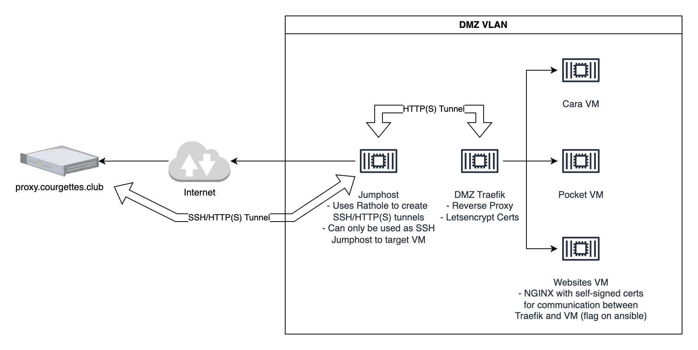

# Courgettes Cloud Infra + Guest Manual

## Infra

The network is split into VLANs.

### Main VLAN

Contains trusted things like laptops, desktops, phones, printer, NAS, PI, Proxmox. Can access every other network.

### Entertainment VLAN

Contains devices like TVs, sound bars, Chromecast. Can be accessed from guest network.

### Guest VLAN

Guests can connect here. Can access entertainment stuff.

### Crusted VLAN

Contains devices like IoT shit, smart things. Can only connect to internet.

### DMZ VLAN

Contains websites and services that can be accessed from the internet.
HTTP(S) and game ports are forwarded from the ISP router.

The DMZ VLAN is as follows:


#### HTTP(S)

The HTTP(S) ports are forwarded from the ISP router to the Traefik DMZ instance. `proxy.courgettes.club` is an alias for
the actual IP of the ISP router, making it effectively the public facing domain name for the Traefik DMZ instance. Any
new public domain wants to route to a DMZ website must CNAME to `proxy.courgettes.club`, or use ddclient (for root
domains).
In the end, DMZ Traefik listens to any traffic on port 80 and 443 of `proxy.courgettes.club` This effectively allows the
Traefik VM to generate LetsEncrypt certs for domains that are `CNAME`d to `proxy.courgettes.club`.

The Websites VMs have a self-signed certificate that is trusted by the Traefik VM for inside-VLAN communication.
The `install_nginx` ansible role handles the creation of the self-signed certs for all hosts needing one.

#### SSH

A `jumphost` VM is spawned in the VLAN as well. Port 22222 from the ISP router is forwarded to it. A `jumphost` user on
the VM is provisioned as well. It is not allowed to run shell, and can only proxy to other hosts in the VLAN.
See [guest manual](#guest-manual) for details. New users need access to the `jumphost` via SSH key, as well as to their
target VMs. Since shell is not available on the jump host, adding their SSH key to the `jumphost` user's config is fine,
and actual access control happens on the VMs themselves.

### Tailscale

Tailscale is installed in an LXC in the Main VLAN, configured as an exit node. It's using userspace network routing (
i.e. so you don't have to change the default settings for LXCs), publishes all the subnet routes in there (so that you
can access all resources if you have access to Tailscale), and has keys expiry disabled - as expected for headless
servers. See details in the [`install_tailscale_exit_node` role](ansible/roles/install_tailscale_exit_node).

Being replaced by NetBird (below); both run side by side until that's tested.

### NetBird and SSO (VPS)

The Infomaniak VPS (`infomaniak_vps`) runs what has to stay up when home is down:

- **Traefik** for `netbird.courgettes.club` and `sso.courgettes.club`/`*.sso.courgettes.club` (certs via the Infomaniak
  DNS challenge).
- **Authelia + lldap** ([`install_authelia`](ansible/roles/install_authelia)): the SSO portal, and the OIDC provider
  NetBird logs in through. lldap's LDAPS (`ldap.sso.courgettes.club:636`) and web UI (`lldap.sso.courgettes.club`) only
  accept mesh addresses (`100.64.0.0/10`).
- **NetBird** ([`install_netbird_server`](ansible/roles/install_netbird_server)): management, signal, relay, STUN and an
  embedded IdP in one container. The embedded IdP has a local **owner** account (the way in when Authelia is down) and
  Authelia as a login option.

NetBird's config (groups, setup keys, routes, exit nodes, policies, DNS) is the [`tofu/netbird`](tofu/netbird) stack.
Peers:

| Peer         | Group            | Role                                                  |
|--------------|------------------|-------------------------------------------------------|
| VPS          | `vps`            | exit node                                             |
| `vpn` LXC    | `home-router`    | routes `10.10.0-5.0/24`, exit node                    |
| minix        | `jellyfin`       | reaches lldap on the VPS (`ldap.sso.courgettes.club`) |
| your devices | `netbird_admins` | everything (the lldap group, synced at login)         |

The mesh uses `100.120.0.0/16` so it doesn't collide with Tailscale. Jellyfin streaming doesn't go through any of this:
`jellyfin.courgettes.club` stays on the home DMZ Traefik. Only Jellyfin's LDAP logins cross the mesh.

#### Installing from scratch

Everything not done by ansible/tofu, in order. Secrets go in the ansible vault
(`ansible/inventory/group_vars/all/vault.sops.yaml`) or `tofu/secrets.enc.yaml`, edited with `sops`.

1. **DNS and firewall (Infomaniak).** Point `netbird`, `sso` and `*.sso` (under `courgettes.club`) at the VPS. Open
   443/tcp and 3478/udp (STUN) in the VPS firewall. Don't open 636.
2. **Vault secrets:**
    - `netbird_owner_email`, and `netbird_owner_password_hash`, a **bcrypt hash**, not the password:
      `htpasswd -bnBC 10 "" 'the-password' | tr -d ':\n'`. A plaintext password gets stored as if it were a hash and
      no login works.
    - `authelia_oidc_netbird_client_secret_digest`, from
      `docker run --rm authelia/authelia:4.39 authelia crypto hash generate pbkdf2 --variant sha512 --random --random.length 72 --random.charset rfc3986`.
      Keep the plaintext secret it prints for step 4.
    - `lldap_user_emails`: one entry per person in `install_authelia`'s `lldap_users`. Password resets and 2FA
      enrolment are sent there, so it must be a mailbox that's actually read.
3. **Deploy the VPS:** `ansible-playbook playbooks/update/update_infomaniak.yml`. Peer enrolment is skipped (no setup
   key yet).
    - NetBird creates the owner on **first startup only**: changing the email or hash later does nothing. To redo it,
      `docker compose down` in `/opt/netbird` and delete `data/idp.db`, `data/store.db` and `data/events.db`. Never
      delete `secrets/`: the store key is in there.
    - lldap users start without a password: each person sets theirs with "reset password" on `sso.courgettes.club`.
4. **API token for tofu.** Log in to `netbird.courgettes.club` as the owner, create a service user (Team → Service
   Users, role Admin) and a token for it. In `tofu/secrets.enc.yaml`: `TF_VAR_netbird_token` (the token) and
   `TF_VAR_netbird_authelia_client_secret` (the plaintext secret from step 2).
5. **Authelia login and group sync:** `cd tofu && make netbird-apply-idp`. On a fresh checkout or worktree run
   `make install` first: the ansible inventory script also needs the other stacks initialised.
6. **Log in with Authelia** on `netbird.courgettes.club` (needs `netbird_users` and `netbird_admins` in lldap, and 2FA).
   NetBird creates a group for each of your lldap groups, `netbird_admins` among them, which the full apply needs. If
   that user should also manage the dashboard, give them the Admin role as the owner (Team → Users): roles don't come
   from groups.
7. **Apply NetBird's config:** `make netbird-plan && make netbird-apply`.
    - Then delete NetBird's default **"All"** policy in the dashboard (Access Control). It isn't managed by tofu and
      lets every peer reach every other.
8. **Setup keys.** `tofu -chdir=netbird output -json setup_keys` → vault, as `netbird_setup_keys` (keys `vps`,
   `home_router`, `jellyfin`). They're one-off: once used, they're no longer needed; a re-installed peer needs a new
   one (`tofu taint` the key, apply again).
9. **`vpn` LXC needs `/dev/net/tun`** to route (NetBird's userspace mode can't): `make core-plan`/`make core-apply`.
10. **Enrol the peers:** `update_infomaniak.yml` again, `update_jumphost_cts.yml` (the Tailscale prompt can be skipped)
   and `update_minix.yml`.
11. **LDAP name for Jellyfin.** Set `vps_mesh_ip` in [`tofu/netbird/variables.tofu`](tofu/netbird/variables.tofu) to the
   VPS's NetBird address (dashboard, or `netbird status` on it), then `make netbird-apply`. This makes
   `ldap.sso.courgettes.club` resolve to the VPS over the mesh on minix only.
12. **Your devices.** Enrol them logged in with Authelia: they get your lldap groups, kept in sync at each login.
    Devices enrolled with the owner account get no access.

#### Checking it works

- From minix: `getent hosts ldap.sso.courgettes.club` gives the VPS's `100.120.x.y`, and
  `openssl s_client -connect ldap.sso.courgettes.club:636` verifies.
- From a device outside home, with Tailscale off: `10.10.0.x` is reachable; with an exit node selected,
  `curl ifconfig.me` gives the VPS's or home's public IP.
- A fresh Jellyfin login (private window) works with an lldap user.

#### Things learnt the hard way

- Authelia's NetBird client must use `client_secret_basic` and put `name` in the ID token (`claims_policy`), or the
  login ends in "Internal Server Error" on NetBird's side.
- The redirect URI is `https://netbird.courgettes.club/oauth2/callback`, without the connector id NetBird's docs show.
- Authelia's connector is of type `pocketid`, not "Generic OIDC" (`oidc`): only the former asks Authelia for the
  `groups` scope. `groups` must also be in the ID token (`claims_policy`). The type can't be changed in place, and a
  new connector means new NetBird users for everyone logging in through Authelia.
- NetBird only puts users into groups it created itself from the claim. A group of the same name created in the
  dashboard or by tofu is never filled, so tofu only looks `netbird_admins` up.
- Authelia answers a password-reset request with success even for an unknown user, without an error in its logs. If
  no email arrives, check the address in lldap first.

## Guest Manual

### Getting a new box

Ask the admin to create a new box. Parameters include:

- Number of CPU
- RAM size
- SSD size (for base drive). Defaults to 4.
- Backed up/replicated HDD size (for data, will be mounted to `/mnt/mounted-raid`)

If it's the first time you ask for a box, sned pulbic shs kye.

### Connecting to a box

Your box will be deployed in the `10.10.5.0/24` network. To access it, use the following ssh config:

```
host jumphost
    hostname proxy.courgettes.club
    user jumper
    port 2222

host mybox
    ProxyJump jumphost
    hostname 10.10.5.<IP>
    user root
```

> Note: all vms have fail2ban installed, don't fuck up the ssh config or you'll get soft banned.

### Network access

Your box has unrestricted outbound internet access.

Regarding inbound internet:

- If you need to publish one or more websites:
    - `CNAME` your domain to `proxy.courgettes.club`
    - Ask for a base `nginx` config with self-signed certs to be installed.
    - Add your nginx reverse proxy config for each one of the websites.
        - A sample can be found in `ansible/roles/install_websites_cts/templates/nginx-reverse-proxy.conf`.
        - You only need to map the HTTPS service to your website.
    - Add config to `ansible/roles/install_traefik_cts/templates/dmz-config.yml`
        - This will both map your domain to your website but also create a letsencrypt cert for it.
        - In this config you can also configure things like http->https redirections, www.domain.com to domain.com
          redirections, mapping multiple domains to the same website, ...
    - Ask for the traefik config to be redeployed. This is not really a piece that should be re-run often so the
      dependency to admin access should be OK.
- If you want to have custom ports mapped to your machine (i.e. game server):
    - Ask for a new port forwarding.